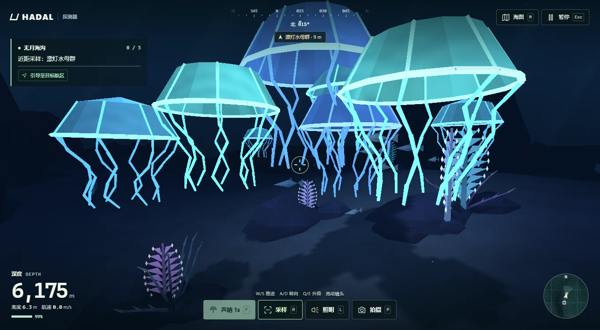
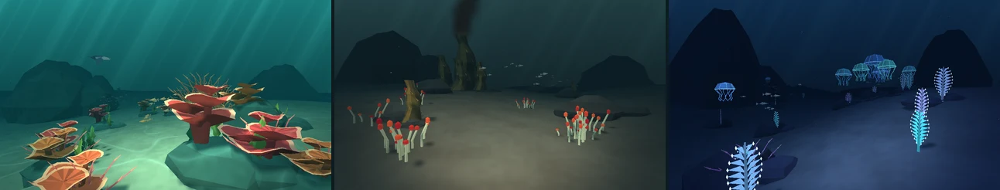

# 深蓝回声 · HADAL SURVEY

一张退役海底观测网还在整点发送回波。你将驾驶遥控潜水器从 186 米的蓝石陆架潜入 6,180 米的无月海沟，检查九处观测目标，找出最后一段信号是谁发来的。

**[进入驾驶舱 ↗](https://kunzi4261-lang.github.io/hadal-survey/)** · 桌面与触屏浏览器均可游玩 · 进度自动保存在本机

*A browser-based deep-sea exploration game. Pilot an ROV through three underwater habitats, map sonar contacts, and piece together the story of a retired observatory.*



## 第一潜怎么开

1. 选择「开始下潜」，按 **F** 发射声呐。顶部显示已定位回波的方位和距离，**M** 打开有等深线的海图。
2. 选中海图上的「珊瑚光标」即可引导航行。也可以手动驾驶，在距离目标 **14 米内**、离底高度 **14 米以内**按 **R**。保持位置几秒，完成第一份光谱记录。
3. 找齐本海区的三份记录，选择「引导返航」。回到泊位后点「对接回收」，从航次报告复核证据，再进入下一海区。



| 海区 | 参考深度 | 要调查的事 |
| --- | ---: | --- |
| HS-01 蓝石陆架 | 186 m | 比对珊瑚旁的照度计、旧航标和沉船的时标，追查那组规律闪光。 |
| HS-02 焰柱裂谷 | 2,140 m | 穿过黑烟喷口，在虫群和着陆器之间寻找中继供电的线索。 |
| HS-03 无月海沟 | 6,180 m | 跟着水母的漂移和海床上的地缆，找到九号站留下的记录。 |

## 驾驶台

| 动作 | 键盘或鼠标 |
| --- | --- |
| 前进 / 倒车，左转 / 右转 | **W / S**、**A / D**，或四个方向键 |
| 下潜 / 上浮，环顾四周 | **Q / E**，按住并拖动视野 |
| 发射声呐，近距采样 | **F**，**R** |
| 打开海图，切换引导航行 | **M**，**G** |
| 切换探照灯，拍摄照片 | **L**，**P** |
| 暂停 / 继续 | **Esc** |

**触屏**上按住左侧方向键驾驶，右侧控制上浮和下潜。拖动海底画面调整视角，点下方的「声呐」或「采样」操作仪器。点「海图」可以选择目标，也可以直接点图中的位置设定航点。引导航行途中，手动操纵即可接管。

## 带什么回到水面

- **航次报告**记录用时、距离、声呐次数、应急回收和评级。返航后可以拖动时间轴回看航迹，跳到指定采样点，或导出 PNG 航迹图和 JSON 报告。
- **科考档案**保存已采样的线索和最多 12 张驾驶舱照片。照片可以导出为 JPEG，确认导出后，可从档案中移除旧照以腾出空间。
- **船载实验台**有三种独立实验。把两路声学波形对齐，测出延迟。沿温度剖面移动探针，找到温差变化最快的深度。翻转电报中出错的比特，用汉明码还原数据。实验数据在本机合成，游戏中的海域与观测记录均为虚构。
- **设置与存档**支持静音、减少动态效果，以及包含驾驶位置、照片和观测记录的 JSON 备份。发布版完成首次资源缓存后可离线重访。

## 本地运行

克隆仓库，在根目录启动静态服务器。Python 3 可直接提供开发预览，打开 [localhost:8000](http://localhost:8000/) 即可驾驶。

```sh
git clone https://github.com/kunzi4261-lang/hadal-survey.git
cd hadal-survey
python -m http.server 8000
```

单元测试和构建仅使用 Node.js 内置模块。以下命令分别运行测试、构建发布文件，并在另一个端口预览含离线缓存的版本。

```sh
node --test
node tools/build.mjs
python -m http.server 8001 --directory dist
```

持续集成使用 Node.js 24，还会用 Chrome 和 Playwright 验证两种屏幕宽度下的离线启动、驾驶、拍照和存档恢复。可以在已安装 Chrome 的电脑上运行同一套浏览器检查。[浏览器验收脚本](tools/browser-check.mjs)

```sh
npm install --no-save --package-lock=false playwright-core@1.56.1
node tools/browser-check.mjs
```

## 实现

| 从哪里读 | 负责什么 |
| --- | --- |
| [潜航与任务模拟](src/core/session.mjs) · [海区定义](src/core/world.mjs) | 以小时间步推进潜水器、海流与电量，判断声呐范围、采样时长与返航条件。海床高度函数同时供驾驶和测绘使用。 |
| [场景渲染器](src/render/scene.mjs) · [着色器](src/render/shaders.mjs) | 原生 WebGL 绘制程序化海床、观测设施和海洋生物。显卡上下文中断时切换到 Canvas 2D，恢复后继续原航次。 |
| [驾驶舱](src/cockpit.mjs) · [航区海图](src/ui/chart.mjs) | 键盘、拖动和触屏共用驾驶指令。仪表、雷达与航迹从当前模拟状态读取。 |
| [航次档案](src/logbook.mjs) · [报告绘制](src/chart.mjs) | 分开保存航次和相册，验证导入的备份，并将实际航迹绘成可下载的报告。 |
| [船载实验台](src/lab.mjs) · [航迹回放](src/replay.mjs) | 实验台用相关系数、局部梯度与汉明码校验读数。回放器按采样时间重建航迹，在俯视图和深度剖面中同步定位。 |
| [构建脚本](tools/build.mjs) · [Pages 工作流](.github/workflows/pages.yml) | 资源内容决定离线缓存版本。主分支通过测试后自动部署到 GitHub Pages。 |

场景画面与首页封面的制作说明见[美术说明](docs/ART.md)。
